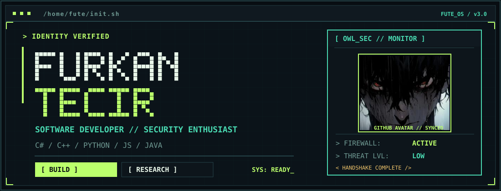
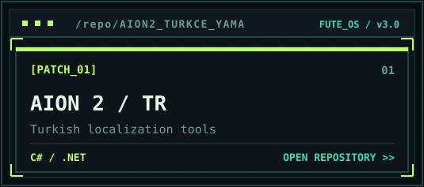
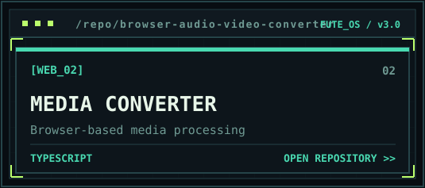
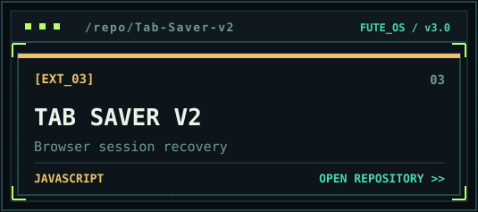
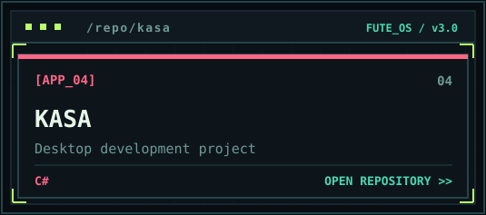
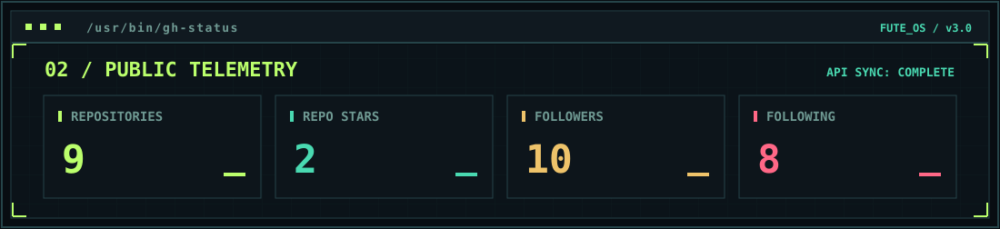
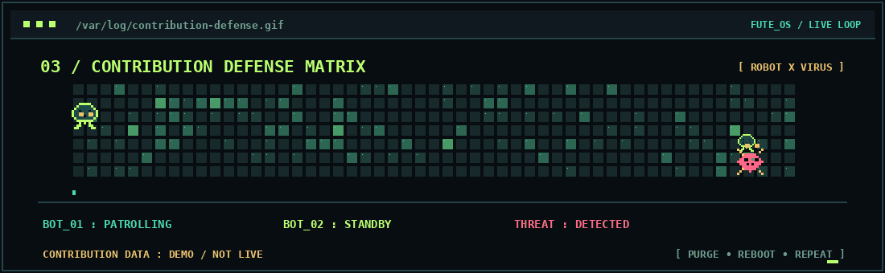

<!-- Direct avatar image provides a GitHub-compatible fallback even if embedded SVG raster is filtered. -->

**`> Building software. Learning security. Shipping experiments._`**

[**WEBSITE**](https://furkantecir.com.tr) &nbsp; `//` &nbsp; [**REPOSITORIES**](https://github.com/furkantecir?tab=repositories) &nbsp; `//` &nbsp; [**FOLLOW**](https://github.com/furkantecir)

### `01 // PROJECT DATABASE`

<table>
<tr>
<td width="50%"></td>
<td width="50%"></td>
</tr>
<tr>
<td width="50%"></td>
<td width="50%"></td>
</tr>
</table>

### `02 // GITHUB TELEMETRY`

### `03 // DEFENSE MATRIX — ROBOTS VS. VIRUS`

`DECORATIVE ROBOTS // REAL CONTRIBUTION COUNTS ONLY AFTER SUCCESSFUL WORKFLOW`

### `04 // TOOLKIT`

`C#` • `C++` • `Python` • `HTML/CSS` • `JavaScript` • `Java` • `Cybersecurity (learning)`

---

FuTe Cyber Arcade v3 · SVG source and generator are editable in this repository. GitHub's own Pinned and contributions sections are controlled by GitHub, not this README.

