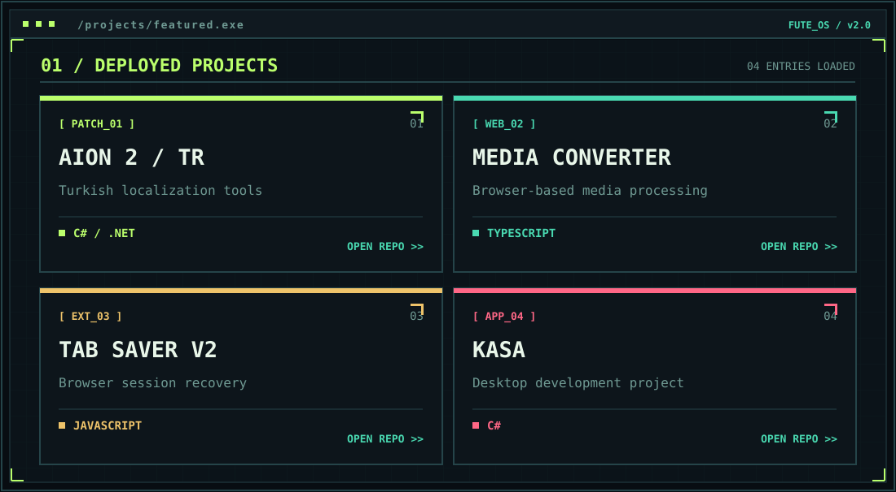

**`> Building software. Learning security. Shipping experiments._`**

[**WEBSITE**](https://furkantecir.com.tr) &nbsp; `//` &nbsp; [**REPOSITORIES**](https://github.com/furkantecir?tab=repositories) &nbsp; `//` &nbsp; [**FOLLOW**](https://github.com/furkantecir)

### `01 // PROJECT DATABASE`

| `ACCESS` | `PROJECT` | `STACK` |
|:--|:--|:--|
| `01` | [**AION 2 / TR**](https://github.com/furkantecir/AION2_TURKCE_YAMA) | `C#` |
| `02` | [**MEDIA CONVERTER**](https://github.com/furkantecir/browser-audio-video-converter) | `TypeScript` |
| `03` | [**TAB SAVER V2**](https://github.com/furkantecir/Tab-Saver-v2) | `JavaScript` |
| `04` | [**KASA**](https://github.com/furkantecir/kasa) | `C#` |

### `02 // GITHUB TELEMETRY`

### `03 // DEFENSE MATRIX — ROBOTS VS. VIRUS`

`DEFENDER BOTS // THREAT SIMULATION // DAILY GITHUB SYNC`

### `04 // TOOLKIT`

`C#` • `C++` • `Python` • `HTML/CSS` • `JavaScript` • `Java` • `Cybersecurity (learning)`

---

FuTe Cyber Arcade — visuals are owned and generated locally. No GitSkins dependency. Pixel bots and viruses are decorative; the contribution data is not altered.

